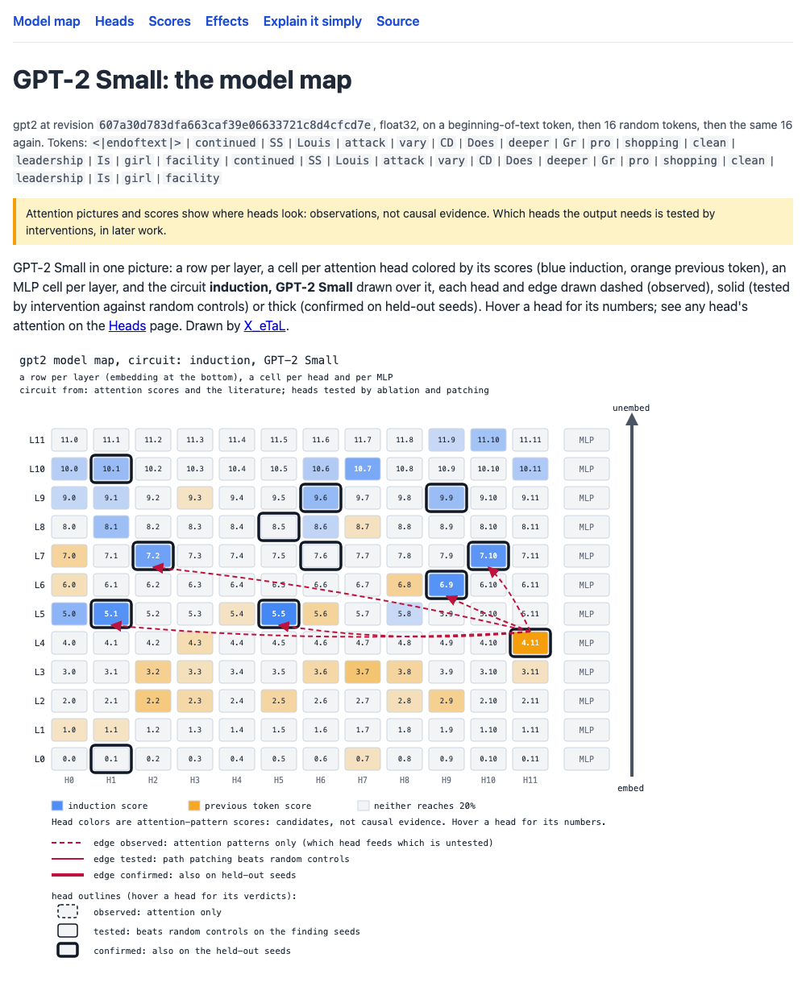
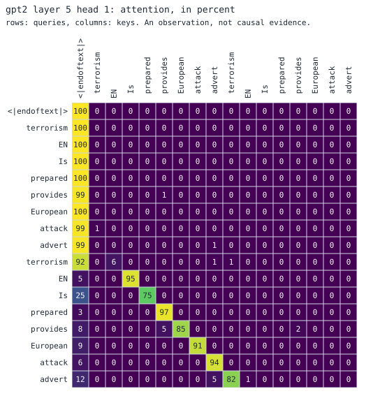
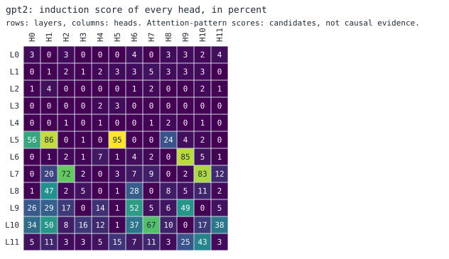
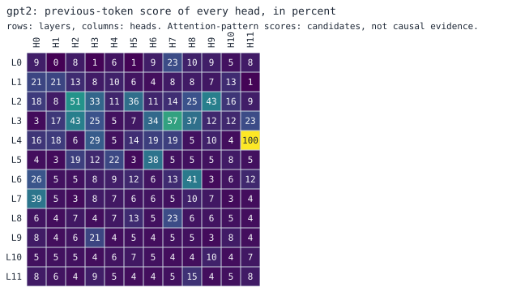
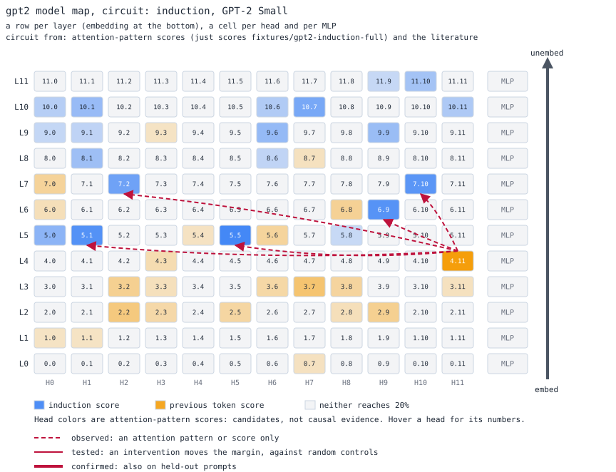
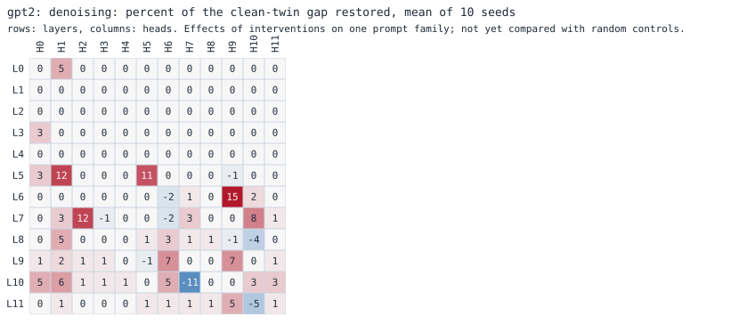
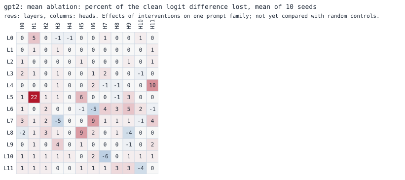
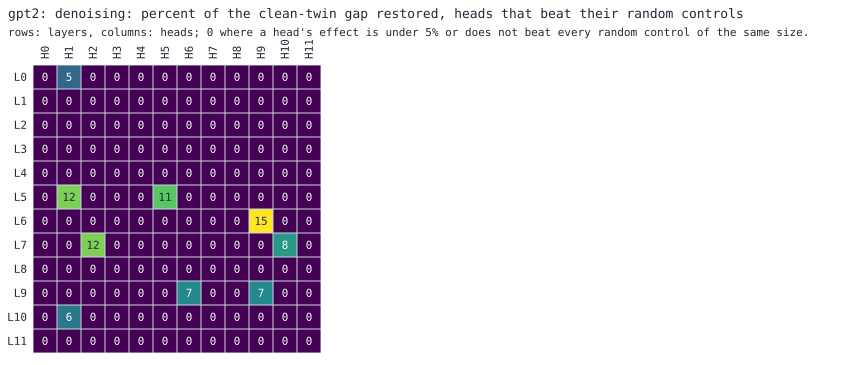
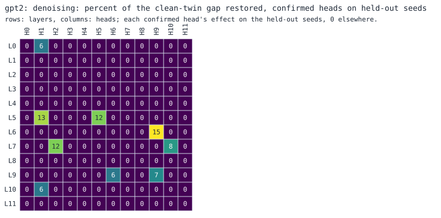

<p align="center">
  
</p>

<p align="center">
  <b><a href="https://softwarewrighter.github.io/X_eTaL-circuits/">The live demo</a></b>
  -- GPT-2 Small's model map, every head's attention and the head scores, drawn by X_eTaL
  <br>
  <a href="https://blog.softwarewrighter.com/series/#array-languages">Read the blog series on array languages</a>
  -- posts on X_eTaL and array languages
</p>

<p align="center">
  <a href="https://softwarewrighter.github.io/X_eTaL-circuits/"></a>
</p>

# X_eTaL-circuits

Find, test and draw *circuits* inside language models, with
[X_eTaL](https://github.com/softwarewrighter/X_eTaL) as the analysis
and visualization language.

A circuit is a set of model components, such as attention heads, MLP
features and the residual-stream paths between them, that cooperate
to produce one behavior. Known examples are an induction head
copying the token that followed an earlier match, and the
key-value associative memory that lets a model learn a mapping like
`good -> foo, bad -> bar` from a few examples in its prompt. Circuits
are not separate programs the model switches between. They are
descriptions of mechanisms inside one fixed, learned computation, and
they can only be found by experiment.

New to this? [`docs/eli5.md`](docs/eli5.md) explains the paper and this
repository in plain words.

> An attention map shows where a model looks. A circuit shows what
> the model needs.

The work here follows the causal method of "A Circuit for In-Context
Learning" (arXiv:2611.05344):

1. **Twin prompts** that differ in exactly one controlled way (swap a
   label, swap a sentence's class), with their tokens lined up.
2. **A continuous measure**: the margin
   `log P(correct) - log P(incorrect)`, not just right or wrong.
3. **Interventions**: activation patching, head ablation and
   steering, swept over layers, heads, positions and Q/K/V. Each
   result is compared with matched random controls.
4. **A circuit graph**, whose edges are tested by path patching and
   validated for faithfulness, completeness and minimality on
   held-out prompts.

These are array computations, a natural fit for an array language. A
patching sweep is a layer x head effect matrix, and an attention
capture is an L x H x T x T tensor. X_eTaL does the slicing,
statistics, graph discovery and drawing. A small adapter (Python
with TransformerLens, at first) runs the model and exposes its
internals.

## Studies

| Model                    | Question                                                         |
| ------------------------ | ---------------------------------------------------------------- |
| GPT-2 Small              | where are the induction heads, and which ones are needed?         |
| local models via Ollama  | do they learn arbitrary labels from examples, and reverse them?   |
| Qwen3-4B-Base            | are the paper's writers, readers, gate and brakes found here too? |
| X_eTaL code              | does the same mechanism carry over to programming-language examples? |
| a tiny trained transformer | in what order do circuit parts appear during training?          |
| Baby Dragon Hatchling    | does a model designed to be inspected make circuits easier to find? |

## Capturing a model run

The adapter runs a model through TransformerLens and writes a
*capture*: a directory with the attention patterns (`attn.xta`, layer
x head x query x key), the last position's logits (`logits.xta`), and
`capture.toml`, which holds the model, its revision, library versions,
the seed, the prompt and its tokens. The arrays are XTLARR01 files
(f32), optionally also one `capture.safetensors`, and for now each
array also as text numbers (`attn.txt`, `logits.txt`), which X_eTaL
reads with `n_umbers []N_GET`. The format is in
[`docs/design.md`](docs/design.md).

```bash
just xetal                                           # X_eTaL at the pinned commit (bin/xetal)
just setup --model                                   # torch + TransformerLens
just capture --out runs/induction --length 50        # BOS + 50 random tokens, twice
just capture --out runs/hello --text "Hello world" --layers 0,5 --safetensors
```

`fixtures/gpt2-induction` is a small capture (GPT-2 Small, two layers,
17 positions) that the tests read. `just fixture` makes it again,
byte for byte.

## Drawing an attention head

`just heatmap` draws one head of a capture as an SVG heatmap, in
X_eTaL (`xetal/Heatmap`): a row per query token, a column per key
token, each cell the attention weight in whole percent, colored on
`[]N_GRID`'s heat scale, and the prompt's tokens on both axes. Layers
and heads are the model's numbers, from 0, so head 5.1 is layer 5,
head 1.

```bash
just heatmap fixtures/gpt2-induction 5 1 images/gpt2-head-5.1.svg
just heatmap fixtures/gpt2-induction 5 5 > head-5.5.svg
```



The prompt is a beginning-of-text token, then eight random tokens,
then the same eight again. On the first half head 5.1 rests on the
first token. On the second half each token looks at the token that
followed its earlier copy: the stripe below the diagonal, which is
what an induction head does. The values X_eTaL reads agree with
TransformerLens's own cache within 1e-5 relative (a test).

This is an observation of where the head looks. It is not evidence
that the head matters to the output; that takes the interventions
of the next studies.

## Scoring every head

`just scores` gives every head two scores, in X_eTaL
(`xetal/Scores`), from a capture of a repeated random-token prompt
with all layers. The **previous-token** score is a head's mean weight
from each position to the one before it. The **induction** score is
its mean weight from each token of the second copy to the token that
followed the same token in the first copy. It prints the leading
heads of each and, given a directory, draws both as layer x head
grids.

```bash
just scores fixtures/gpt2-induction-full
just scores fixtures/gpt2-induction-full images/gpt2-scores
```

```text
Head scores from attention patterns only: candidates, not causal evidence.
gpt2 at 607a30d783dfa663caf39e06633721c8d4cfcd7e, a beginning token then 16 random tokens, twice.

induction
5.5 95%
5.1 86%
6.9 85%
7.10 83%
7.2 72%
10.7 67%
5.0 56%
9.6 52%
10.1 50%
9.9 49%

previous token
4.11 100%
3.7 57%
2.2 51%
2.9 43%
3.2 43%
6.8 41%
7.0 39%
5.6 38%
3.8 37%
2.5 36%
```





The five leading induction heads, 5.5, 5.1, 6.9, 7.10 and 7.2, are
the GPT-2 Small induction heads known from the literature, and 4.11
is its known previous-token head. The scores agree with the same
scores computed from TransformerLens's cache within 1e-5 relative (a
test). `fixtures/gpt2-induction-full` is GPT-2 Small on a beginning
token then 16 random tokens twice, all 12 layers.

These scores are candidates: they say where heads look, not that the
output needs them. Whether it does is tested by switching heads off
and patching them, in the next studies.

## The model map

`just map` draws the whole model in one picture, in X_eTaL
(`xetal/Map`): a row per layer with the embedding at the bottom and
the unembedding at the top, a cell per attention head and one per
MLP, and the residual stream beside them. Each head is colored by its
scores: blue for induction, orange for previous token, deeper for
higher, gray when neither reaches 20%. Hovering a head shows its
numbers. MLPs have no score yet.

A circuit is drawn over the map from a file in
[`experiments/circuits/`](experiments/README.md): its heads and its
edges, each edge with the evidence it has reached.

| Line | Evidence |
| ---- | -------- |
| dashed | observed: an attention pattern or score only |
| solid | tested: an intervention moves the margin, against matched random controls |
| thick | confirmed: also on held-out prompts |

```bash
just map fixtures/gpt2-induction-full experiments/circuits/gpt2-induction.toml images/gpt2-model-map.svg
```



Heads carry evidence too, drawn as their outline: dashed observed,
solid tested (beats random controls on the seeds used to find it),
thick confirmed (also on held-out seeds); hovering a head gives each
method's verdict. The circuit drawn has twelve confirmed heads: the
previous-token head 4.11, the induction heads 5.1, 5.5, 6.9, 7.2 and
7.10, and six the interventions found whose roles are not yet known
(7.6, 8.5, 9.9, 9.6, 10.1, 0.1). Its edges, 4.11 feeding the induction
heads, are still dashed: switching a head off or patching it tests the
head, not which head feeds which. Path patching will test the edges,
and the same map will draw them solid, then thick.

## Testing heads by intervention

Attention patterns name candidates; interventions test them. The
experiment `experiments/induction.toml` pairs each repeated prompt with
a twin whose second copy is fresh tokens, and measures the logit
difference between the right next token and the twin's at each
position of the second copy (see
[`experiments/README.md`](experiments/README.md)). `just ablate`
switches off one head at a time; `just patch` copies one head's output
between the twins. `just effects`, in X_eTaL (`xetal/Effects`), reads
the runs, one per seed, and gives each head's mean effect and its
spread over the seeds, in percent.

```bash
just effects fixtures/gpt2-induction-ablation images/gpt2-effects
just effects fixtures/gpt2-induction-patch images/gpt2-effects
```

```text
zero ablation: percent of the clean logit difference lost, over 10 seeds; not yet compared with random controls.

7.6 15% +- 4
5.5 13% +- 4
1.3 12% +- 5
0.1 11% +- 5
0.10 10% +- 9
5.9 10% +- 3
5.1 10% +- 6
3.0 7% +- 4
0.9 7% +- 4
1.1 7% +- 3

mean ablation: percent of the clean logit difference lost, over 10 seeds; not yet compared with random controls.

5.1 22% +- 6
4.11 10% +- 3
7.6 9% +- 4
8.5 9% +- 2
5.5 6% +- 3
0.1 5% +- 3
6.9 5% +- 2
9.3 4% +- 1
7.11 4% +- 1
6.7 4% +- 2
```

```text
denoising: percent of the clean-twin gap restored, over 10 seeds; not yet compared with random controls.

6.9 15% +- 2
5.1 12% +- 2
7.2 12% +- 2
5.5 11% +- 2
7.10 8% +- 1
9.9 7% +- 1
9.6 7% +- 2
10.1 6% +- 1
0.1 5% +- 3
10.0 5% +- 1

noising: percent of the clean-twin gap destroyed, over 10 seeds; not yet compared with random controls.

5.1 25% +- 7
7.6 10% +- 4
8.5 9% +- 3
0.1 7% +- 3
5.5 6% +- 4
6.9 6% +- 3
9.3 5% +- 2
7.11 4% +- 2
6.7 4% +- 3
8.2 4% +- 2
```





Restoring one head's output into the twin brings back the most for
6.9, 5.1, 7.2, 5.5 and 7.10: the five induction heads the attention
scores named. Removing one head costs little except for 5.1: the heads
back each other up. 7.6 and 8.5 matter when removed but restore little
on their own. The next section says which of these effects beat
random controls.

## Which heads beat their controls

An effect counts only if chance cannot explain it. For each head,
`just controls` makes 20 changes to its output of the same size as the
real intervention's, in random directions. A head passes when its mean
effect is at least 5% and larger than every one of its controls'.
`just verdict`, in X_eTaL, lists the heads that pass:

```bash
just verdict fixtures/gpt2-induction-ablation fixtures/gpt2-induction-patch fixtures/gpt2-induction-controls images/gpt2-effects
```

```text
mean ablation: percent of the clean logit difference lost: 6 of 144 heads have an effect of at least 5% and beat all 20 of their random controls.

5.1 22% (controls up to 4%)
4.11 10% (controls up to 4%)
7.6 9% (controls up to 1%)
8.5 9% (controls up to 0%)
5.5 6% (controls up to 2%)
6.9 5% (controls up to 3%)

denoising: percent of the clean-twin gap restored: 9 of 144 heads have an effect of at least 5% and beat all 20 of their random controls.

6.9 15% (controls up to 1%)
5.1 12% (controls up to 1%)
7.2 12% (controls up to 0%)
5.5 11% (controls up to 1%)
7.10 8% (controls up to 1%)
9.9 7% (controls up to 0%)
9.6 7% (controls up to 0%)
10.1 6% (controls up to 0%)
0.1 5% (controls up to 2%)
```



These heads are **tested** on the seeds used to find them; the next
section checks them on held-out seeds.

## Confirmed on held-out seeds

Heads that pass on the seeds used to find them are only **tested**. The
same experiment, controls and rule then run on ten held-out seeds that
played no part in choosing heads or the threshold; a head that passes
again is **confirmed**. `just confirm` takes the two sets of runs by
their common prefix:

```bash
just confirm fixtures/gpt2-induction fixtures/gpt2-induction-heldout images/gpt2-effects
```

```text
mean ablation: percent of the clean logit difference lost: 5 of the 6 heads that pass on the 10 finding seeds pass again on the 10 held-out seeds.

5.1 finding 22%, held-out 22%: confirmed
4.11 finding 10%, held-out 13%: confirmed
7.6 finding 9%, held-out 8%: confirmed
8.5 finding 9%, held-out 7%: confirmed
5.5 finding 6%, held-out 5%: confirmed
6.9 finding 5%, held-out 4%: tested only (fails on held-out seeds)

denoising: percent of the clean-twin gap restored: 9 of the 9 heads that pass on the 10 finding seeds pass again on the 10 held-out seeds.

6.9 finding 15%, held-out 15%: confirmed
5.1 finding 12%, held-out 13%: confirmed
7.2 finding 12%, held-out 12%: confirmed
5.5 finding 11%, held-out 12%: confirmed
7.10 finding 8%, held-out 8%: confirmed
9.9 finding 7%, held-out 7%: confirmed
9.6 finding 7%, held-out 6%: confirmed
10.1 finding 6%, held-out 6%: confirmed
0.1 finding 5%, held-out 6%: confirmed
```



So GPT-2 Small's output on repeated text needs 5.1, 4.11, 7.6, 8.5 and
5.5 (switching any of them off costs 5-22% of the logit difference,
far more than a random change of the same size), and restoring any of
the five induction heads, or 9.9, 9.6, 10.1 or 0.1, brings back 5-15%
of what the twin lost. Which head feeds which is not yet tested: that
takes path patching.

## The live demo

`just pages` builds the site from the committed captures into
`work/site`: the model map (hover a head for its numbers), every
head's attention heatmap with a layer and head picker, the score
grids, and [`docs/eli5.md`](docs/eli5.md). Every picture is drawn by
X_eTaL, exactly as at the command line. A GitHub Actions workflow
(`.github/workflows/pages.yml`) builds and deploys it on each push to
main. `just screenshot` retakes the picture at the top of this README
with headless Chrome.

```bash
just pages                 # work/site; open work/site/index.html
just screenshot            # images/demo.png
```

## Status

Early: the adapter writes captures, X_eTaL reads and checks them
(`xetal/Capture`), draws any head as a heatmap (`xetal/Heatmap`),
scores every head (`xetal/Scores`) and draws the model map with a
circuit over it (`xetal/Map`, see [`xetal/README.md`](xetal/README.md)).
The [live demo](https://softwarewrighter.github.io/X_eTaL-circuits/)
shows all of it. Interventions (ablation and patching) are measured
and drawn, compared with random controls and confirmed on held-out
seeds, and the model map draws each head's evidence. Testing which
head feeds which (path patching) comes next.
[`docs/plan.md`](docs/plan.md).

## Documentation

- [`docs/eli5.md`](docs/eli5.md) -- the paper and this repository,
  explained simply
- [`docs/plan.md`](docs/plan.md) -- the roadmap, principles and open
  questions
- [`docs/reference.md`](docs/reference.md) -- the paper's method, the
  authors' code and the TransformerLens hooks for GPT-2 Small
- [`docs/design.md`](docs/design.md) -- the capture format, the rules
  and the decisions behind them
- `docs/xetal-*-asks.md` -- what this repository needs from its sibling
  repositories, one ledger each
- [`docs/research.txt`](docs/research.txt) -- the archived design
  conversation behind the project (not normative)

## Development

Development is test-driven and tracked with agentrail sagas; see
[`CLAUDE.md`](CLAUDE.md) (also `AGENTS.md`) for the agent workflow
and rules.

```bash
just setup                # adapter/.venv (uv), the adapter and its dev tools
just setup --model        # also torch and TransformerLens
just check                # adapter lint and tests, markdown checks
agentrail status          # current saga state
agentrail next            # the current step and its context
```

The model adapter is a Python package in `adapter/`, always run from
its own uv environment (`adapter/.venv`), never the system Python.

## The X_eTaL repositories

- [X_eTaL](https://github.com/softwarewrighter/X_eTaL) -- the
  language: a terse, statically typed, functional array language in
  plain ASCII, decorated typographically.
- [X_eTaL-libraries](https://github.com/softwarewrighter/X_eTaL-libraries)
  -- libraries written in X_eTaL itself.
- [X_eTaL-extensions](https://github.com/softwarewrighter/X_eTaL-extensions)
  -- small native Rust libraries used from X_eTaL like any other
  library.
- [X_eTaL-demos](https://github.com/softwarewrighter/X_eTaL-demos) --
  small programs worth watching.
- [X_eTaL-games](https://github.com/softwarewrighter/X_eTaL-games) --
  games and puzzles whose rules are array-shaped.

## Related Projects

- [in-context-learning-circuit](https://github.com/andrewgcodes/in-context-learning-circuit)
  -- the code and prompt batteries for arXiv:2611.05344.
- [TransformerLens](https://github.com/TransformerLensOrg/TransformerLens)
  -- hooks for capturing and patching transformer activations.
- [bdh](https://github.com/pathwaycom/bdh) -- the Baby Dragon
  Hatchling reference implementation.
- [sw-mlpl](https://github.com/sw-ml-study/sw-mlpl) -- Software
  Wrighter's Machine Learning Programming Language, a Rust array
  language inspired by APL, APL2, J, and BQN.

## Links

- Blog: [Software Wrighter Lab](https://software-wrighter-lab.github.io/)
- Discord: [Join the community](https://discord.com/invite/Ctzk5uHggZ)
- YouTube: [Software Wrighter](https://www.youtube.com/@SoftwareWrighter)

## Copyright

Copyright (c) 2026 Michael A Wright

## License

MIT. See [`LICENSE`](LICENSE) and [`COPYRIGHT`](COPYRIGHT).
